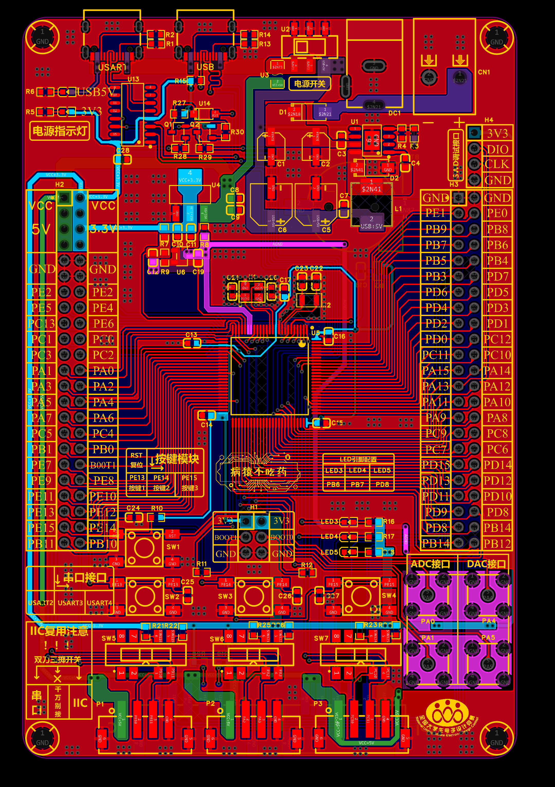
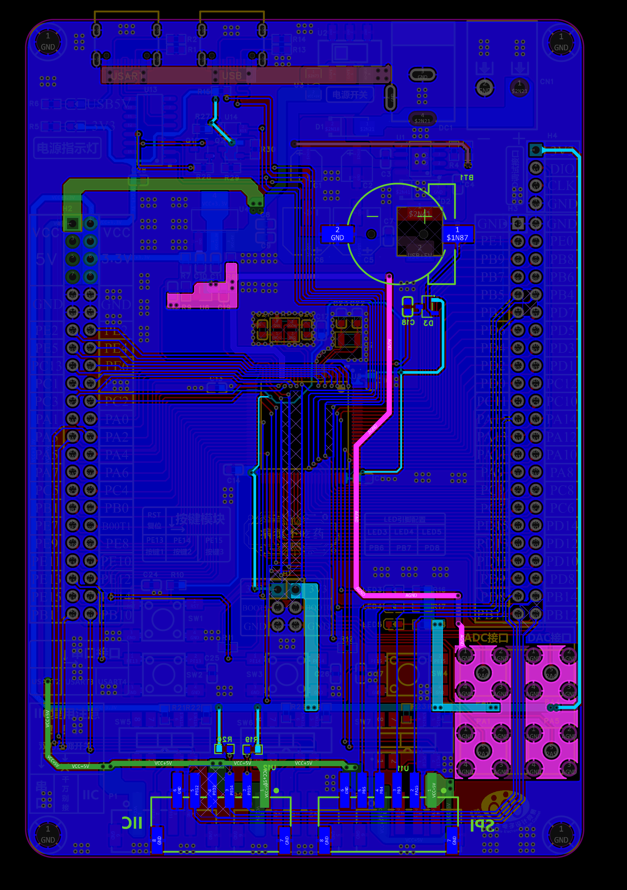
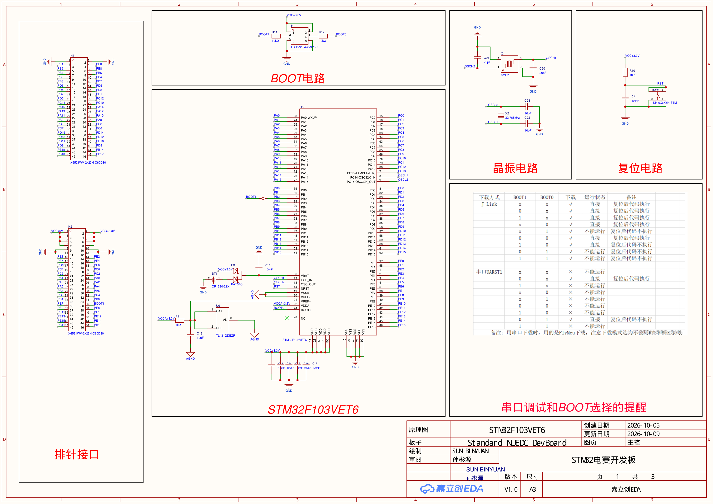
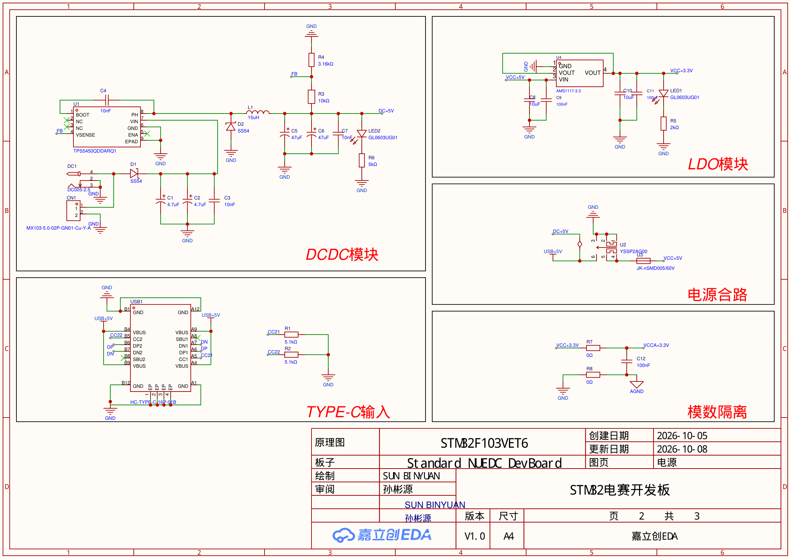
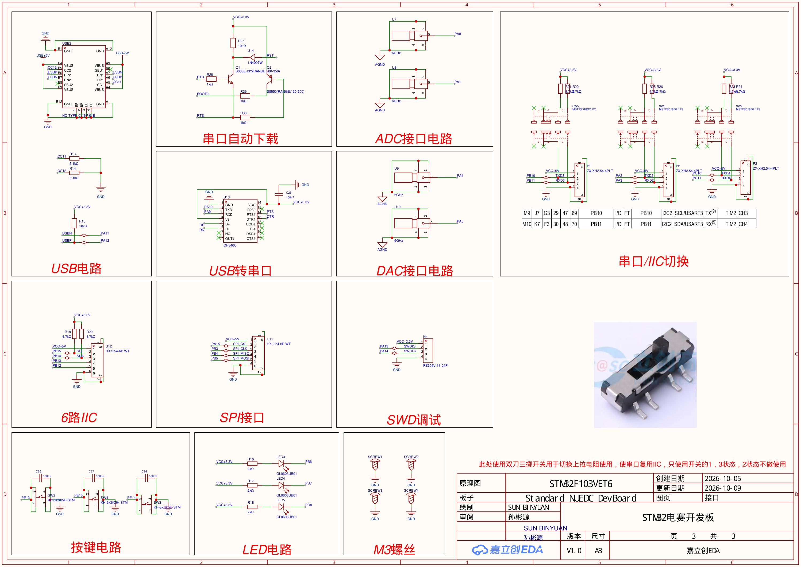
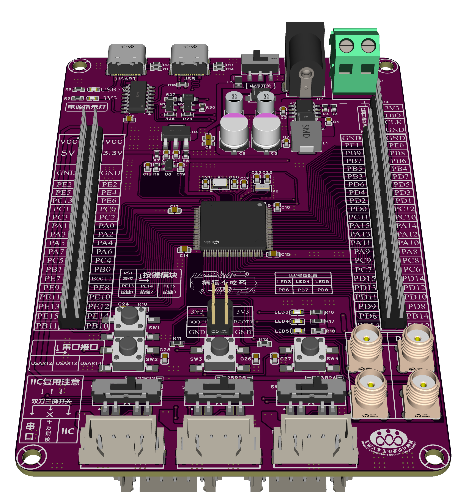
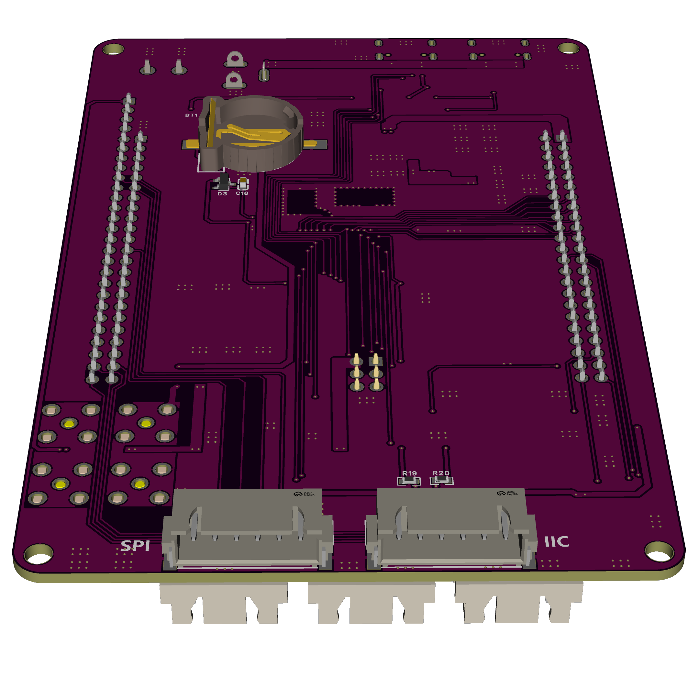

# Standard NUEDC DevBoard（电赛标准开发板）

自绘的全国大学生电子设计竞赛（NUEDC）通用开发板，主控 **STM32F103VET6**（LQFP100，Flash 512K / RAM 64K），板版本 V1.0（2026-10 打板）。

> [!WARNING]
> 首版板子未经长期验证，**可能存在错误，请谨慎使用**（同目录下的原始声明文件保留）。

## 仓库结构

| 目录 | 内容 |
|---|---|
| `PCB工程文件/` | 立创EDA专业版工程（.epro2）、BOM、网表、PCB PDF、顶层/底层渲染图 |
| `原理图/` | 原理图 PDF（3 页：主控 / 电源 / 接口） |
| `Code_Demo/` | 5 个 VSCode + CMake + arm-none-eabi-gcc 示例工程（含 HAL 库，克隆即编译） |
| `AI_Development/` | 全部元器件引脚连接方式文档、个人 C 编程规范、Keil 移植踩坑笔记 |
| `keil移植脚本/` | keil2cubevscode 脚本（bat / ps1） |

硬件数据手册因体积与版权原因不上传，元器件型号见 BOM（`PCB工程文件/BOM_*.xlsx`），手册请到立创商城 / 厂商官网查询。

## 板载资源

### PCB 预览

| 顶层（TOP） | 底层（BOTTOM） |
|---|---|
|  |  |

### 原理图

| 页 | 内容 |
|---|---|
| 第 1 页 |  |
| 第 2 页 |  |
| 第 3 页 |  |

高清 PDF 版本见 [原理图/SCH_Standard NUEDC DevBoard.pdf](原理图/SCH_Standard%20NUEDC%20DevBoard.pdf)。

### 3D 预览

| 顶层（TOP） | 底层（BOTTOM） |
|---|---|
|  |  |

### 电源

- 输入三选一（合路共网，无防反灌设计）：DC005 插座 / XH2.54-5.0 接线端子 / 两路 Type-C VBUS
- DC 输入经 SS54 肖特基防反接 → TPS5450 降压（5.5 A Buck，15 µH）→ 前级 5V → 拨动开关 → 自恢复保险丝 → 板级 5V
- AMS1117-3.3 线性稳压 → 3.3V（数字），0Ω 桥接模拟 3.3V/AGND；VREF+ 由 TL431 提供独立基准
- CR1220 纽扣电池经 BAT54C 双阳极二极管给 VBAT 供电（RTC 备用）
- 电源指示灯：5V 绿色 LED ×1、3.3V 绿色 LED ×1

### 主控最小系统

- STM32F103VET6（LQFP100，512K Flash / 64K RAM）
- 8 MHz 主晶振（HSE）+ 32.768 kHz RTC 晶振（LSE）
- 复位按键 + RC；BOOT0/BOOT1 跳帽排针（H1）选择启动方式
- SWD 四针调试口（3.3V / SWDIO / SWCLK / GND，未引出 NRST）

### 通信与下载

| 外设 | 引脚 | 说明 |
|---|---|---|
| USB 转串口 | Type-C ×1 + CH340C | USART1（PA9/PA10），配 Q1/Q2 自动下载电路（DTR/RTS 控制 BOOT0/RESET） |
| 原生 USB | Type-C ×1 | PA11/PA12，Device 模式，D+ 10kΩ 上拉 |
| 串口/I²C 扩展 ×3 | P1: PB10/PB11（USART3）、P2: PA2/PA3（USART2）、P3: PC10/PC11（UART4） | XH2.54-4P 端子（5V/信号/信号/GND）；各配双刀滑动开关切换 4.7kΩ 上拉接入 |
| SPI 扩展 | U11: PA15(CS)/PB3(CLK)/PB4(MISO)/PB5(MOSI) | SPI1 重映射布局，6P 端子，需释放 JTAG 引脚 |
| I²C 扩展 | U12: PB15(SCL)/PB14(SDA) + PB13/PB12 | SCL/SDA 固定 4.7kΩ 上拉；“6路IIC”实为 6 针端子非 6 路独立 I²C |

### 模拟接口

| 外设 | 引脚 | 说明 |
|---|---|---|
| ADC 输入 ×2 | SMA 座：PA0、PA1 | 外壳接 AGND，中心端直连 MCU |
| DAC 输出 ×2 | SMA 座：PA4、PA5 | 无缓冲/钳位，VREF+ 为 TL431 独立基准 |

### 人机交互

- 用户 LED ×3：PB6、PB7、PD8（蓝色，2kΩ 限流，低电平点亮）
- 用户按键 ×3：PE13、PE14、PE15（按下接地，带 100nF 滤波，无外部上拉——固件需开内部上拉）

### 扩展

- GPIO 排针 ×2（H2/H3，各 46 针 2.54mm）：H2 含 5V/3.3V/GND 电源针，H3 含 GND；全部 GPIO 与板载外设共网，注意复用冲突
- M3 接地安装孔 ×4

> 引脚级细节（逐元器件、逐引脚、全部 124 个网络）见 `AI_Development/所有元器件的连接方式.md`，由原理图 PDF 与网表 TEL 双重核对生成。

### 已知注意事项（详见连接方式文档 §5）

- 三路 5V 输入（USB×2 + DC）在开关之前共网，无防反灌/自动择源，避免同时供电
- 各扩展端子供电为 5V 但信号直连 3.3V MCU，无电平转换
- “串口/I²C 切换”开关只切换上拉接入，不改变引脚外设复用，需固件配合配置

## 示例工程

| 工程 | 说明 |
|---|---|
| `KEY_LED` | 按键控制 LED |
| `LED_HEARTBEAT` | 心跳灯 |
| `PWM_LED` | PWM 呼吸灯 |
| `USART1_KEY` | 串口 + 按键 |
| `IIC_TEST` | I2C 外设测试 |

工具链：VSCode + STM32Cube 插件 + CMake + Ninja + arm-none-eabi-gcc（不依赖 Keil；`keil移植脚本/` 用于把 Keil 工程转成该流程）。`build/` 目录不入库，进入工程目录 configure 一次即可重新生成。

烧录：J-Link SWD（工程内附 .jlink 脚本）。

## 工程配置流程（从克隆到运行）

以 `Code_Demo/KEY_LED` 为例，5 个示例工程步骤完全一致：

1. **安装工具链**（一次性）
   - VSCode + STM32Cube 插件（`stm32-vscode-extension`）
   - arm-none-eabi-gcc（GCC ARM Embedded，建议 13.x 及以上）
   - CMake ≥ 3.22、Ninja
   - J-Link 软件包（含 `JLink.exe` / `JLinkGDBServer`）

2. **克隆仓库**，进入任一示例工程目录，如 `Code_Demo/KEY_LED`。工程结构：

   ```
   KEY_LED/
   ├── CMakeLists.txt          # 根 CMake（用户可编辑，含用户扩展区域）
   ├── CMakePresets.json       # Debug / Release 预设，生成器 Ninja
   ├── cmake/
   │   ├── gcc-arm-none-eabi.cmake   # 交叉编译工具链文件
   │   └── stm32cubemx/        # 源文件、include、宏定义（迁移自动生成）
   ├── Core/  Drivers/         # HAL 库 + 用户代码
   ├── STM32F103VE_FLASH.ld    # 链接脚本（512K Flash / 64K RAM）
   ├── KEY_LED.ioc             # CubeMX 工程（改外设配置用）
   └── flash.jlink             # J-Link 烧录脚本
   ```

3. **Configure**：在工程根目录执行一次（`build/` 不入库，克隆后必须重新生成）：

   ```bash
   cmake --preset Debug
   ```

   工具链由 `cmake/gcc-arm-none-eabi.cmake` 自动查找；若 gcc 不在 PATH，在 VSCode 的 STM32Cube 插件设置里指定工具链路径即可。

4. **编译**：

   ```bash
   cmake --build build/Debug
   ```

   产物在 `build/Debug/`（.elf/.hex/.bin），编译数据库 `compile_commands.json` 供 clangd/IntelliSense 使用。

5. **烧录**（J-Link SWD 接板上 4 针调试口）：

   ```bash
   JLink -CommanderScript flash.jlink        # 只烧 app
   # 或完整擦除+烧录：JLink -CommanderScript flash_full.jlink
   ```

   也可直接用 VSCode 任务（`.vscode/tasks.json` 已配置一键编译/烧录）。

6. **修改外设配置**（可选）：用 STM32CubeMX 打开 `KEY_LED.ioc` 调整引脚/外设/时钟，重新生成代码；源文件列表在 `cmake/stm32cubemx/` 下，新增源文件后重新 configure 即可。

## 开发规范

本仓库代码遵循 `AI_Development/个人编程代码规范.md`

## License

MIT。
